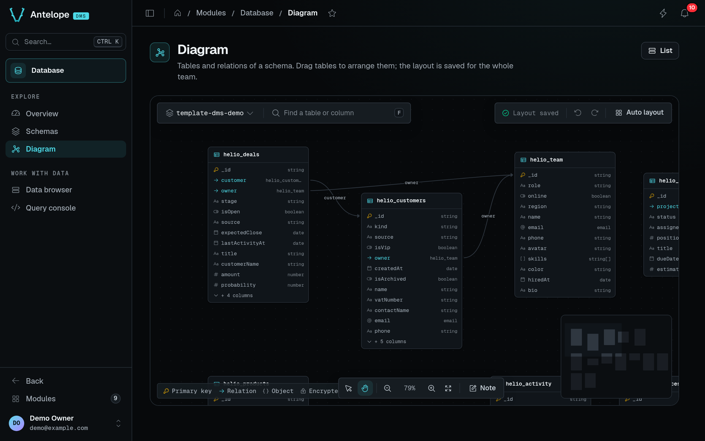

<a href="https://github.com/AntelopeJS/dms"></a>

<div align="center">

# `@antelopejs/dms-database`

<a href="https://www.npmjs.com/package/@antelopejs/dms-database"></a> <a href="./LICENSE"></a> <a href="https://discord.gg/g4pFt6eXqu"></a> <a href="https://dms.antelopejs.com/docs/modules/database"></a> <a href="https://github.com/AntelopeJS/dms"></a>

**See your schemas, browse and fix rows, and run queries, from the dashboard your team already uses.**

[Try it in the live demo](https://dms-demo.antelopejs.com/modules/database/overview) · [Documentation](https://dms.antelopejs.com/docs/modules/database) · [All modules](https://github.com/AntelopeJS/dms#modules)

</div>



## What it does

- Checks the connection and its latency, with one card per registered schema and the largest tables.
- Lists every table the loaded modules register, with its columns, indexes, relations and a sample row.
- Draws the tables and relations of a schema, with a layout and notes shared by the whole team.
- Browses and fixes rows in any instance: edits are staged, reviewed, saved, and can be undone for ten seconds.
- Runs AQL queries with completion and history, and a dry run before any query that writes.

A saved row shows in place; the page is read again when a save may move rows (a sorted or filtered field, or a search).

The pages and the module's API answer to the platform owner only.

## Install

Run the AntelopeJS CLI from the root of a project that already loads `@antelopejs/dms`:

```bash
ajs project modules add @antelopejs/dms-database
```

## Quick start

The module works without configuration. To show the database name on the Overview and label your schemas, add a `config` block:

```ts fragment
// antelope.config.ts
"dms-database": {
  source: { type: "package", package: "@antelopejs/dms-database", version: ">=0.4.4 <0.5.0" },
  config: {
    driverLabel: "MongoDB 8.0",
    schemaLabels: {
      "app-*": { label: "Application", color: "info" },
    },
  },
},
```

Restart the backend, then the frontend, sign in as the platform owner and open **Modules → Database** (`/modules/database/overview`).

## Compatibility

<!-- antelopejs-docs-compat:start -->

| Package                                     | Supported          | Tested with |
| ------------------------------------------- | ------------------ | ----------- |
| `@antelopejs/interface-api`                 | `>=0.3.3 <0.4.0`   | `0.3.3`     |
| `@antelopejs/interface-api-util`            | `>=0.3.2 <0.4.0`   | `0.3.2`     |
| `@antelopejs/interface-core`                | `>=0.5.1 <0.6.0`   | `0.5.1`     |
| `@antelopejs/interface-database`            | `>=0.4.0 <0.5.0`   | `0.4.0`     |
| `@antelopejs/interface-database-catalog`    | `>=0.0.4 <0.1.0`   | `0.0.4`     |
| `@antelopejs/interface-database-decorators` | `>=0.5.2 <0.6.0`   | `0.5.2`     |
| `@antelopejs/interface-dms`                 | `>=0.14.0 <0.15.0` | `0.14.0`    |
| `@antelopejs/interface-dms-automation`      | `>=0.6.2 <0.7.0`   | `0.6.2`     |
| `@antelopejs/interface-dms-builder`         | `>=0.5.1 <0.6.0`   | `0.5.1`     |

<!-- antelopejs-docs-compat:end -->

The module also needs a DMS backend in a release that implements the `@antelopejs/interface-dms` range above, and the `@antelopejs/dms-frontend` renderer in the range its frontend module declares in `engines["@antelopejs/dms-frontend"]` of `frontend-vue/package.json`; the `ajs dms` CLI refuses to build it with a renderer outside that range, and an `@antelopejs/interface-database` implementation, such as `@antelopejs/mongodb`.

## Documentation

- [Introduction](https://dms.antelopejs.com/docs/modules/database/introduction)
- [Installation](https://dms.antelopejs.com/docs/modules/database/installation)
- [Configuration](https://dms.antelopejs.com/docs/modules/database/configuration)
- [Usage](https://dms.antelopejs.com/docs/modules/database/usage/overview)
- [Extending](https://dms.antelopejs.com/docs/modules/database/extending)
- [FAQ](https://dms.antelopejs.com/docs/modules/database/faq)

The canonical guide lives in [`docs/`](./docs), including the [supported extension boundary](./docs/5.extending.md#supported-extension-boundary). There is no separate DMS Database interface package. The package also ships the `dms-database` Claude Code skill in [`skills/`](./skills), declared under `antelopeJs.skills`.

## Contributing

Read [CONTRIBUTING.md](./CONTRIBUTING.md) before opening a pull request. The playground registers a `demo` schema and a `shop` schema with `eu` and `us` instances, seeded on first start. It runs on MongoDB by default; set `PLAYGROUND_DATABASE=postgres` to run it on PostgreSQL through `@antelopejs/postgres`, with `POSTGRES_URL` naming the database (default `postgres://postgres@localhost:5432/playground_dms_database`, which must exist).

One root install includes the backend and shipped Vue module, retaining their separate lockfiles. The playground remains independent: run `pnpm --dir playground install --ignore-workspace --frozen-lockfile` before starting it. Use the root scripts below rather than recursive scripts: frontend `build` and `typecheck` need the playground or a generated Inertia workspace, and root lint already checks the Vue module.

```bash
pnpm install
pnpm dev            # playground backend
pnpm frontend:dev   # dashboard, in a second terminal
pnpm lint
pnpm typecheck
pnpm test
```

<details>
<summary>Repository notes</summary>

- The module registers its Vue 3 frontend through `frontend-vue/dms.frontend.ts`, under the `DmsDatabase` component prefix: `app/components/DataBrowser.vue` is the `DmsDatabaseDataBrowser` the backend page names. The pages are declared in `src/pages`, as DMS blocks plus the module's own components. Everything under `frontend-vue/app/build` is private to the layer and imported by path.
- Run `pnpm test:layer` for the frontend tests and `pnpm test:frontend` to build and typecheck a generated Inertia app. Set `DMS_FRONTEND_WORKSPACE` to a generated Inertia workspace before running `pnpm --dir frontend-vue typecheck`.
- `DMS_SOURCE=/absolute/path/to/dms pnpm test` tests against a local DMS runtime with disposable MongoDB and filesystem storage. Only the test harness loads that runtime; the types come from `@antelopejs/interface-dms`.
- `docs/design/redesign-v2-grill.md` records the decisions behind the v2 redesign.

</details>

## Part of AntelopeJS DMS

This module installs into [AntelopeJS DMS](https://github.com/AntelopeJS/dms), the open-source back office. Every module adds its pages to the same dashboard, behind the same sign-in and roles.

<!-- antelopejs-dms-modules:start -->

| Module                                                           | What it adds                                                                             |
| ---------------------------------------------------------------- | ---------------------------------------------------------------------------------------- |
| [`dms-builder`](https://github.com/AntelopeJS/dms-builder)       | Edit pages, tables and data sources by clicking, as TypeScript that compiles             |
| [`dms-ai`](https://github.com/AntelopeJS/dms-ai)                 | An assistant chat in the dashboard, on your own Claude Code or Codex                     |
| [`dms-database`](https://github.com/AntelopeJS/dms-database)     | Schemas, relation diagrams, a data browser and a query console                           |
| [`dms-api`](https://github.com/AntelopeJS/dms-api)               | API health, request logs, per-route statistics and a request tester                      |
| [`dms-automation`](https://github.com/AntelopeJS/dms-automation) | Node-graph automations on schedules, webhooks and DMS events, with a trace for every run |
| [`dms-mailing`](https://github.com/AntelopeJS/dms-mailing)       | E-mail templates in a block editor, versions, a send log and delivery metrics            |
| [`dms-lang`](https://github.com/AntelopeJS/dms-lang)             | Translation coverage, a translation matrix and a translation queue                       |
| [`dms-media`](https://github.com/AntelopeJS/dms-media)           | A media library with folders, per-folder permissions, image sizes and light editing      |
| [`dms-saas`](https://github.com/AntelopeJS/dms-saas)             | Self-service sign-up, plans that gate features, and Stripe billing                       |
| [`dms-marketing`](https://github.com/AntelopeJS/dms-marketing)   | Traffic, conversion funnels with A/B splits and click heatmaps, without cookies          |
| [`dms-frontend`](https://github.com/AntelopeJS/dms-frontend)     | The `ajs dms` CLI, the Vue renderer and the SDK every frontend module builds on          |

<!-- antelopejs-dms-modules:end -->

## License

[Apache-2.0](./LICENSE)
