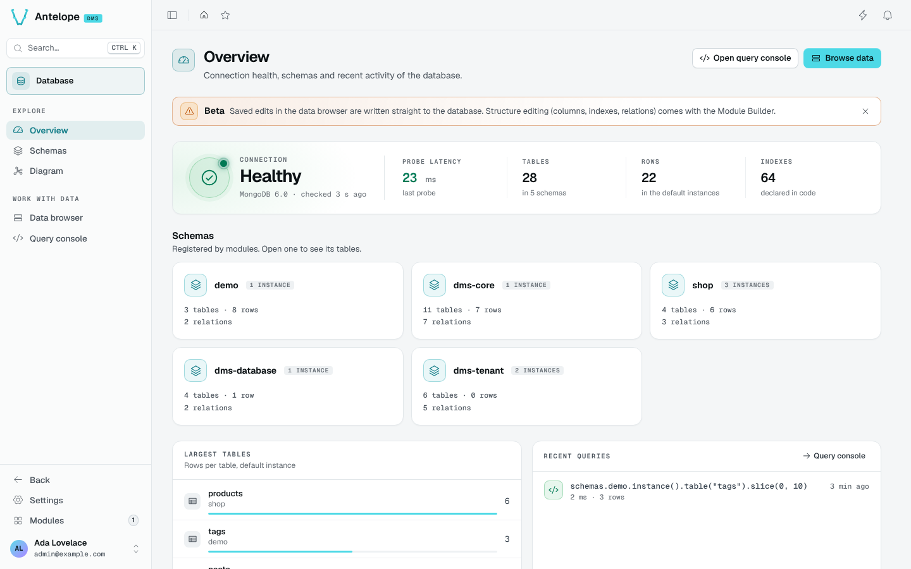

# Introduction

`@antelopejs/dms-database` is the database console of the AntelopeJS DMS. It reads every schema the loaded modules register through the Database interface and gives the platform owner one place to check the connection, understand the structure, browse rows, fix a value and run a query.

## What it brings

The module adds a **Database** entry to the Modules catalog, with five pages under `/modules/database`:

::card-group
  :::card{title="Overview" icon="i-lucide-gauge" to="/docs/modules/database/usage/overview"}
  Connection health and probe latency, one card per schema, the largest tables and the latest queries.
  :::

  :::card{title="Schemas" icon="i-lucide-layers" to="/docs/modules/database/usage/schemas"}
  Every registered table with a filter bar kept in the URL and an inspector for columns, indexes, relations and a sample row.
  :::

  :::card{title="Diagram" icon="i-lucide-network" to="/docs/modules/database/usage/diagram"}
  The tables and relations of a schema, with a layout and notes shared by the whole team.
  :::

  :::card{title="Data browser" icon="i-lucide-rows-3" to="/docs/modules/database/usage/data-browser"}
  The rows of any table in any instance. Edits are staged, reviewed, saved, and can be undone for ten seconds.
  :::

  :::card{title="Query console" icon="i-lucide-code" to="/docs/modules/database/usage/query-console"}
  AQL with completion, a history, saved and shared queries, and a dry run before any query that writes.
  :::
::

## Who it is for

The pages are reserved to the **platform owner**: the DMS gates every `/modules/database` route owner-only, and the module's API answers only to the owner. Tenants and their members never see it.

::warning
Saved edits in the data browser, and confirmed write queries, go straight to the database.
::

## Requirements

- A DMS backend in a release that implements the `@antelopejs/interface-dms` range in the [README compatibility table](https://github.com/AntelopeJS/dms-database#compatibility), and the `@antelopejs/dms-frontend` renderer in the range declared by `engines["@antelopejs/dms-frontend"]` of `frontend-vue/package.json`. The `ajs dms` CLI refuses to build the module with a renderer outside that range.
- An implementation of `@antelopejs/interface-database`, such as `@antelopejs/mongodb`.
- Optional: `@antelopejs/dms-automation`, to use the [Table watch trigger](/docs/modules/database/extending#table-watch-automation-trigger).

## Next steps

::steps
### Install the module

Follow [Installation](/docs/modules/database/installation) to add it to a DMS project.

### Label your schemas

Set the driver name and schema labels in [Configuration](/docs/modules/database/configuration).

### Explore your data

Start from the [Overview](/docs/modules/database/usage/overview), then open the [Schemas](/docs/modules/database/usage/schemas) list.
::
