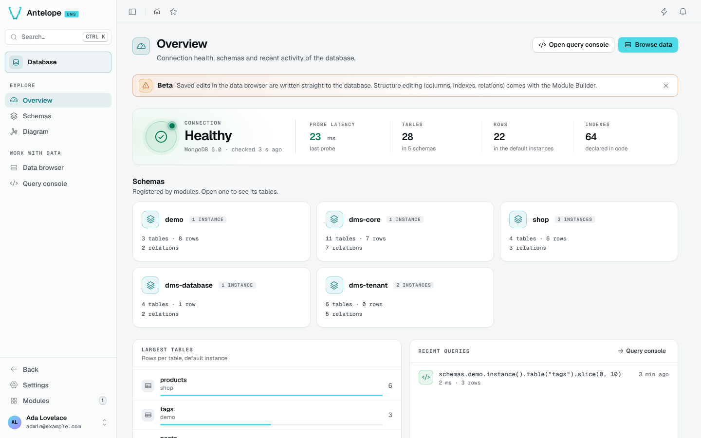

`@antelopejs/dms-database` is the database console of the AntelopeJS DMS. It reads every schema that the loaded modules register through the Database interface. The platform owner uses it to check the connection, read the structure, browse rows, fix a value and run a query, all in one place.

## What it brings

The module adds a **Database** entry to the **Modules** catalog. Its sidebar groups five pages under `/modules/database`. **Overview**, **Schemas** and **Diagram** sit under **Explore**, and **Data browser** and **Query console** sit under **Work with data**.

::card-group
  :::card{title="Overview" icon="i-lucide-gauge" to="/docs/modules/database/usage/overview"}
  Connection health and probe latency, one card per schema, the largest tables and the latest queries.
  :::

  :::card{title="Schemas" icon="i-lucide-layers" to="/docs/modules/database/usage/schemas"}
  Every registered table with a filter bar kept in the URL and an inspector for columns, indexes, relations and a sample row.
  :::

  :::card{title="Diagram" icon="i-lucide-network" to="/docs/modules/database/usage/diagram"}
  The tables and relations of a schema, with a layout and notes shared by the whole team.
  :::

  :::card{title="Data browser" icon="i-lucide-rows-3" to="/docs/modules/database/usage/data-browser"}
  The rows of any table in any instance. Edits are staged, reviewed, saved, and can be undone for ten seconds.
  :::

  :::card{title="Query console" icon="i-lucide-code" to="/docs/modules/database/usage/query-console"}
  AQL with completion, a history, saved and shared queries, and a dry run before any query that writes.
  :::
::

## Who it is for

Only the **platform owner** can use the module. The DMS opens module pages to the owner only, and every route of the module's API carries `@AuthOwnerOnly()`. Tenants and their members never see the module.

::warning
Saved edits in the data browser, and confirmed write queries, go straight to the database.
::

## Requirements

- A DMS backend in a release that implements the `@antelopejs/interface-dms` range in the [README compatibility table](https://github.com/AntelopeJS/dms-database#compatibility), and the `@antelopejs/dms-frontend` renderer in the range declared by `engines["@antelopejs/dms-frontend"]` of `frontend-vue/package.json`. The `ajs dms` CLI refuses to build the module with a renderer outside that range.
- An implementation of `@antelopejs/interface-database`, such as `@antelopejs/mongodb`.
- `@antelopejs/dms-automation`, if you want the [Table watch trigger](/docs/modules/database/extending#table-watch-automation-trigger). Without it, the module runs and registers no trigger.

## Next steps

::steps
### Install the module

Follow [Installation](/docs/modules/database/installation) to add it to a DMS project.

### Label your schemas

Set the driver name and schema labels in [Configuration](/docs/modules/database/configuration).

### Explore your data

Start from the [Overview](/docs/modules/database/usage/overview), then open the [Schemas](/docs/modules/database/usage/schemas) list.
::
