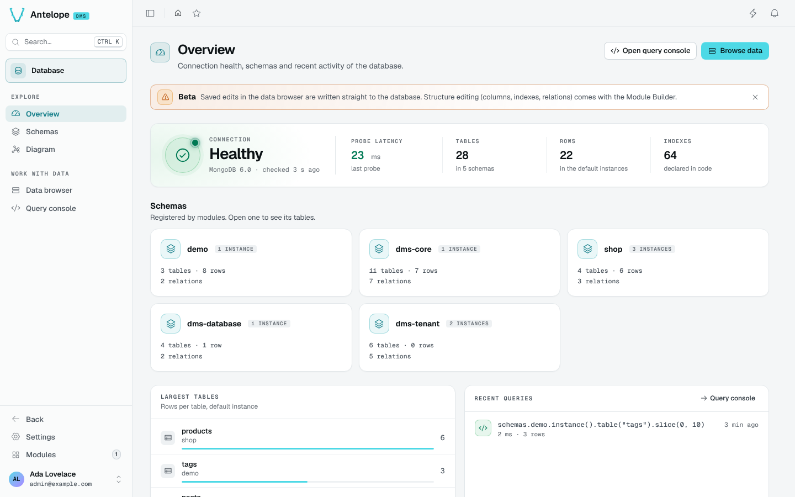

The Overview is the landing page of the module (`/modules/database/overview`). It shows on one screen whether the database is reachable, what it holds, and what has been run against it lately.

The header has two buttons that open the working pages, **Open query console** and **Browse data**.

## Connection

The connection card probes the database through the Database interface. The probe times a listing of the instances of the first registered schema, and runs again every 30 seconds while the page is open.

When the probe answers, the card shows these facts:

- The state, **Healthy**, with the database name from [`driverLabel`](/docs/modules/database/configuration) and the time of the last check.
- The **Probe latency** of that check, in milliseconds. With no schema registered, nothing is probed and the latency shows `—`.
- The number of **Tables**, and the number of schemas they belong to.
- The number of **Rows** in the default instances.
- The number of **Indexes** declared in code.

When the probe fails, the state reads **Unavailable**. The card then shows the **Last error** the probe threw and the time to the **Next probe**, and a **Check again** button probes at once.

## Schemas

The Schemas section has one card per registered schema, the schema with the most rows first. A card shows the schema's number of instances, tables, rows and relations, and the schema's label when it has one. A label comes from [`schemaLabels`](/docs/modules/database/configuration#schema-labels) or from a built-in pattern. The rows are counted in the default instance. A card opens the [Schemas](/docs/modules/database/usage/schemas) list filtered on that schema.

## Largest tables and recent queries

**Largest tables** ranks the five tables with the most rows in their default instance, across every schema. Each table opens in the data browser.

**Recent queries** lists your last five runs in the [query console](/docs/modules/database/usage/query-console), newest first. A failed run reads **Failed**. Each run opens in the query console, and the **Query console** link opens the console itself.
