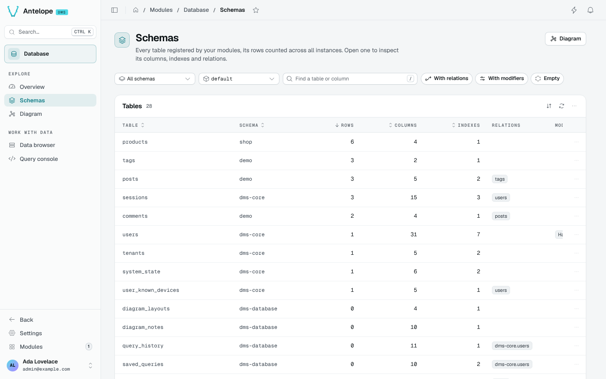
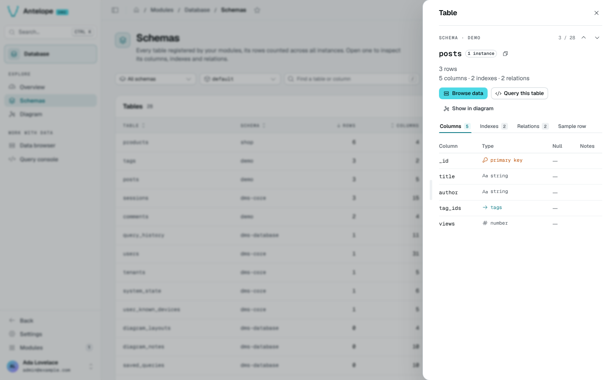

The Schemas page (`/modules/database/schemas`) lists every table that the loaded modules register. Each row shows the table's schema, its rows counted in the picked instance, and its column, index and relation counts. The list opens sorted by rows, largest first, 50 tables per page. The **Diagram** button in the header opens the [Diagram](/docs/modules/database/usage/diagram) page.

## Filter the tables

The filter bar narrows the list. The URL keeps every filter, so a filtered list can be shared, bookmarked or reloaded.

| Filter | What it does |
| --- | --- |
| Schema | Shows the tables of one schema, or of all schemas. |
| Instance | Counts the rows of the default instance, of one named instance (a tenant or a region, for example), or of all instances. The named instances are listed once a schema is picked. |
| Find a table or column | Matches table names and column names. `/` focuses the field, and `Esc` clears it. |
| With relations | Keeps the tables that point to another table. |
| With modifiers | Keeps the tables with hashed, localized or encrypted columns. |
| Empty | Keeps the tables with no row in the picked instance. |

While a filter is set, the bar shows how many tables match out of the total (`12 of 87 tables`) and a **Clear** button.

The list sorts by **Table**, **Schema**, **Rows**, **Columns** or **Indexes**. The **Relations** column names the tables each table points to, with the schema in front of a table from another schema (`shop.orders`). The **Modifiers** column flags **Hashed**, **Localized** and **Encrypted** columns.

## Inspect a table

A click on a row opens the table inspector in a drawer on the right. The drawer header names the table and its position in the list ("Table 3 of 87"). The previous and next buttons, or `K` and `J`, step through the tables in the order the list shows them. The URL keeps the open table (`?record=<schema>::<table>`). The drawer edge resizes the drawer, and the drawer opens at the width you last gave it on this device.

The inspector names the table's schema and its number of instances, and has a button that copies the table name. Below that, it shows the row count across every instance and the column, index and relation counts. A table with more than one instance also links to the data browser to browse it instance by instance.

The inspector has four tabs. On a narrow drawer, the tabs and the column table scroll sideways.

- **Columns** lists each column with its name, its type, whether it takes `null`, and notes such as **Hashed** or **Encrypted**. The type is **primary key**, the target table of a relation, or the scalar or object type. A column typed `string | null` shows `string` under **Type** and **yes** under **Null**.
- **Indexes** lists the indexes declared in code, each marked **single** or **compound**, with its columns.
- **Relations** lists the tables this table points to (**References**) and the tables that point to it (**Referenced by**). A relation opens the other table in the same drawer.
- **Sample row** shows one row of the table as JSON, with its position ("Row 1 of 240 · default instance"). The row comes from the default instance, or from the first named instance that holds rows when the default instance is empty. **Another row** shows the next row.

From the inspector, **Browse data**, **Query this table** and **Show in diagram** open the other pages on the same table. The row menu of the list has the same actions, after **Inspect**.
