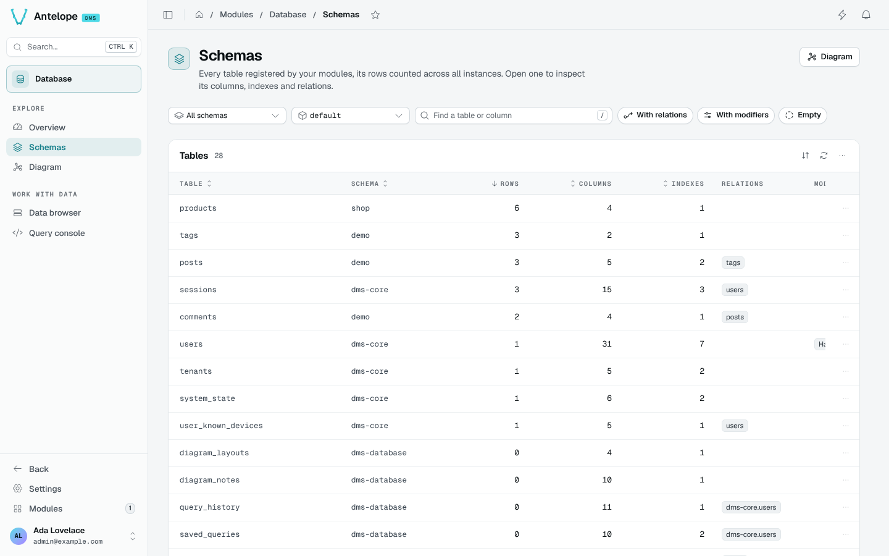
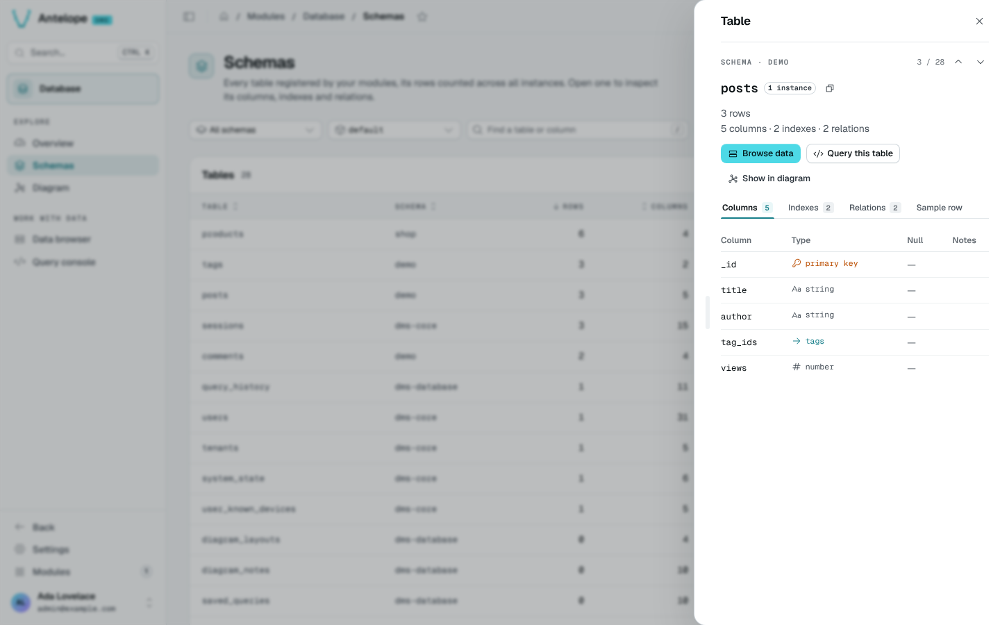

# Schemas

The Schemas page (`/modules/database/schemas`) lists every table registered by the loaded modules, its rows counted in the picked instance, with its column, index and relation counts.

## Filter the tables

The filter bar narrows the list. Every filter is kept in the URL, so a filtered list can be shared or bookmarked.

| Filter | What it does |
| --- | --- |
| Schema | Shows the tables of one schema, or all of them. |
| Instance | Counts the rows of one instance (`default`, a tenant, a region), or of all instances. |
| Find a table or column | Matches table and column names. Press `/` to focus it. |
| With relations | Keeps the tables that point to another table. |
| With modifiers | Keeps the tables with hashed, localized or encrypted columns. |
| Empty | Keeps the tables with no row in the picked instance. |

Columns sort by name, schema, rows, columns or indexes. The **Relations** column names the tables each one points to, and **Modifiers** flags hashed, localized and encrypted columns.

## Inspect a table

Click a row to open the inspector in a drawer on the right. Its header names the table and its position in the list ("Table 3 of 87"); the previous and next buttons, or `J` and `K`, step through the tables as the list shows them, and the URL keeps the open table (`?record=<schema>::<table>`). Drag the drawer's edge to resize it: it opens at the width you last left it.

The inspector shows the row, column, index and relation counts, and four tabs:

- **Columns**: name, type (primary key, relation target, scalar or object type), whether it takes `null` (`string | null` shows as `string`, with **yes** under **Null**) and notes such as hashed or encrypted. On a narrow drawer the table scrolls sideways, as do the tabs.
- **Indexes**: the indexes declared in code.
- **Relations**: the tables this one points to and the tables pointing to it. A relation opens the other table.
- **Sample row**: one row of the table.

From the inspector, **Browse data**, **Query this table** and **Show in diagram** open the other pages on the same table. The row menu of the list offers the same actions.
