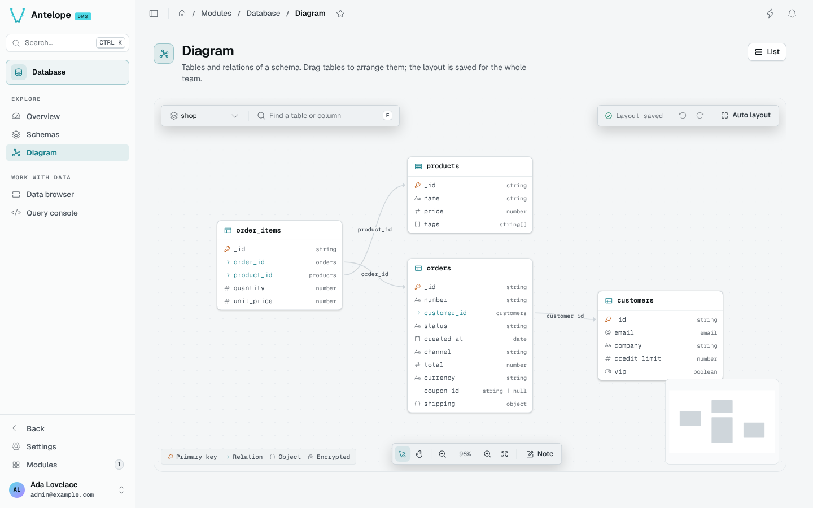

The Diagram page (`/modules/database/diagram`) draws the tables of one schema and the relations between them. The schema picker sits at the top left, next to the search field. Without a `schema` parameter, the page opens on the first registered schema. A link with `?schema=<schema>&table=<table>` opens the schema centred on that table. The **List** button in the header opens the [Schemas](/docs/modules/database/usage/schemas) page.

## Read the diagram

Each table lists its columns with their types. Icons mark the **Primary key**, **Relation**, **Object** and **Encrypted** columns, and the legend at the bottom left names them. A relation is an arrow from its column to the table it points to. A relation to a table that is not drawn ends on a dashed chip. That table is in another schema, or **Focus** leaves it out. The chip opens that table.

A table with more than 12 columns comes folded. It shows its first 12 columns, its primary key and every column an arrow starts or ends on, then a **+ N columns** row. A click on that row unfolds the table, as does `Enter` on the focused row. **Fold columns** folds it back. A search that finds a column hidden in a folded table unfolds that table. Folding belongs to your own visit and is not saved with the team's layout.

A schema too large to fit the view at 40 % zoom opens at 40 %, on the top-left corner of the diagram. The overview map at the bottom right and **Fit view** (`1`) show the whole diagram. **Fit view** never zooms past 100 %. On a narrow screen, the overview map and the legend are hidden.

The search field (`F`) finds a table by its name or by a column name. `Enter` centres the next match.

## Select, focus and inspect

A click on a table selects it, and the bar at the top shows its name with two buttons:

- **Inspect** opens the table inspector. A double-click on a table does the same.
- **Focus** draws only the selected table and the tables it is related to. **Show all tables** draws the whole schema again.

The inspector opens in a drawer on the right, titled with the table's name, as on the [Schemas](/docs/modules/database/usage/schemas#inspect-a-table) page. A relation opens the other table in the same drawer. The diagram's tables are not a list, so the drawer has no position and no `J` or `K`.

A schema with more than 40 tables shows a hint to select a table and focus on it.

## Arrange the layout

A table moves by drag. The layout saves itself after each change (**Layout saved**), and everyone who opens the diagram sees the same layout.

**Auto layout** previews a computed arrangement first and shows how many tables it moves. **Keep layout** applies it, and **Discard** or `Esc` goes back to your layout. Undo and redo cover table moves, kept auto layouts, and the notes you add, move, edit or delete.

The computed arrangement keeps each group of related tables together, laid out left to right along their relations. It places the groups first, largest first, then the tables without relations, in rows shaped like the canvas. Tables without relations are sorted by name prefix (the part before `__`, such as `dms-core__`) and then by name, so a module's tables sit side by side. Tables without a prefix come last. Tables count at their folded height, and the arrangement keeps clear of the notes, which never move.

A table that the team has not placed yet takes its place in that arrangement. Tables already placed stay where they are until you run **Auto layout**.

## Notes

**Note** (or `N`) adds a sticky note to the canvas. A double-click on a note opens it for writing. Notes are saved with the schema and shared with the team.

## Keyboard shortcuts

The shortcuts work when the focus is on the canvas or on the page itself. They do nothing while you type in a field or while a drawer is open. Letters work in either case. `Ctrl` stands for `Cmd` on macOS.

| Key | Action |
| --- | --- |
| `F` | Find a table or a column |
| `N` | Add a note |
| `V` | Select tool |
| `H` | Pan tool |
| `1` | Fit the view |
| `0` | Zoom to 100 % |
| `Ctrl` `Z` | Undo |
| `Ctrl` `Shift` `Z`, `Ctrl` `Y` | Redo |
| `Esc` | Step back: the layout preview, then the focus, then the selection |

The DMS **Shortcuts** settings page lists these shortcuts with the shortcuts of every other module.
