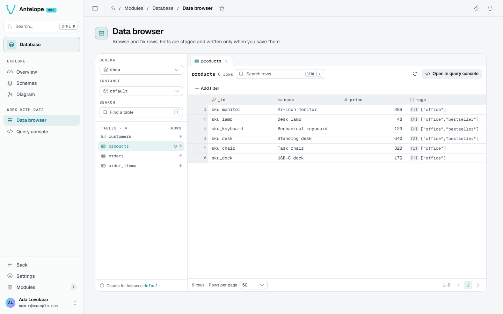
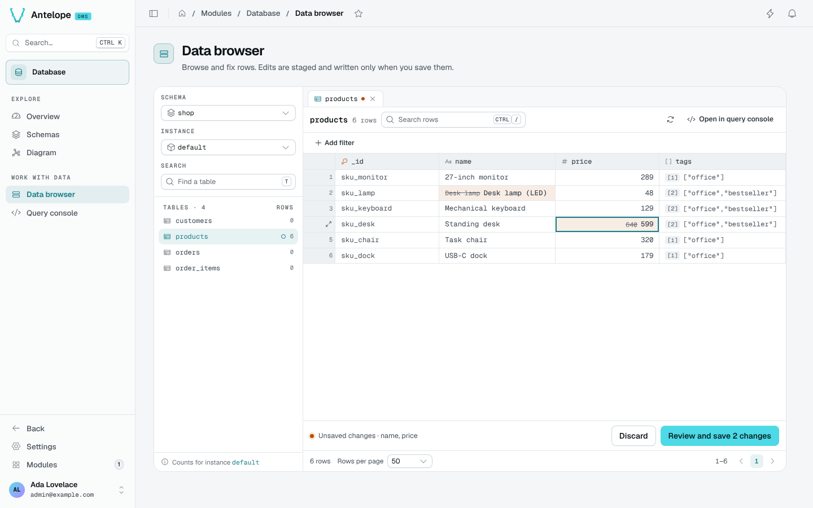

The Data browser (`/modules/database/data`) shows the rows of any registered table. The left panel picks a schema, an instance and a table. Each table opens in a tab, and several tables stay open side by side.

## Pick a table

The left panel has three parts:

- **Schema** picks the schema.
- **Instance** picks `default`, a named instance, or **All instances**.
- **Find a table** (`T`) narrows the table list, which shows each table's row count in the picked instance.

A click on a table opens it in a preview tab, shown in italics. The next table you open replaces the preview tab. A double-click, or the **Keep tab** button, keeps the tab open. A tab that holds staged edits is kept too. Closing a tab with staged edits asks first, with **Discard and close** and **Keep editing**.

Links into the browser carry the selection in the URL:

| Parameter | Value |
| --- | --- |
| `schema` | The schema id, for example `shop`. |
| `table` | The table name, for example `products`. |
| `instance` | Absent for the default instance, `all` for every instance, or the name of a named instance. |
| `match` | `<column>:<value>`. Opens the table filtered on that value with an **is exactly** filter, as the query console's row links do. |

## Browse rows

- **Search rows** (`Ctrl` `/`) searches the open table. It matches a case-insensitive substring in any cell of a row.
- **Add filter** adds a column filter, `contains` or `is exactly`. Each active filter shows as a chip that removes it, and **Clear all** removes every filter.
- A click on a column header sorts by that column, ascending, then descending, then unsorted.
- The footer pages through the rows. **Rows per page** offers 25, 50, 100 or 200 rows, and a new tab starts at 50.
- **Refresh** (`R`) reads the page again.
- **Open in query console** opens the [Query console](/docs/modules/database/usage/query-console) on the same table, prefilled with `.slice(0, 100)`.

When no row matches, the empty state offers **Clear filters** and **Search all instances**.

## Read across instances

With **All instances** picked, the browser reads the table across every instance at once. That view is read-only. A banner says "Read-only." and offers one **Switch to** button per instance. The backend refuses edits in that view too, with "Editing is disabled when browsing across all instances".

## Open a row

`Space` opens the focused row in a side drawer, and so does the open-row button that replaces the row number on hover. The drawer's header names the row by its id and gives its position on the page ("Row 3 of 50"). The previous and next buttons, or `J` and `K`, move between the rows of the page.

The drawer has three tabs:

- **Fields** edits each column. A long text or a JSON value gets a text area across the drawer, and the dashed-circle button (**Set to null**) sets a value to `null`. The primary key is not editable.
- **JSON** shows the row as JSON, staged edits included.
- **Referenced by** counts the rows of other tables that point to this row.

The drawer's footer counts the row's unsaved changes and holds **Review and save** for every staged change of the table. In the all-instances view the drawer is read-only, with no **Referenced by** tab and no footer.

## Edit, review and save

The browser stages edits. Nothing is written as you type.

### Edit cells

A double-click on a cell, or `Enter` on the focused cell, opens its editor. `Enter` or a click elsewhere stages the value, and `Esc` cancels. Typing `null` empties the cell, and `\null` stores the text "null". A number, boolean or date column refuses a value of the wrong type and names the expected format.

An object or array cell opens a JSON editor in a side drawer that fills the drawer's height. **Apply** stages the value, which must be a JSON object, an array or `null`. **Cancel** leaves the cell as it was.

A staged cell shows the stored value struck through before the new one.

### Review

Once a change is staged, the bar at the bottom says "Unsaved changes" and names the changed columns. **Review and save** (`Ctrl` `S`) opens a dialog that lists every change, old value and new value, before anything is written. **Discard** drops the staged changes.

### Save, or undo

The dialog's **Save** button (for example "Save 2 changes") writes the changes with one request per row. **Keep editing** closes the dialog and keeps the changes staged. If a row no longer exists, its changes are dropped. If a write fails, the rows not written stay staged.

For ten seconds after a save, **Undo** writes the previous values back. A new edit, or a switch to another tab, ends the undo offer.

::warning
A saved edit writes straight to the database, outside of any module's business logic. Prefer the module's own pages to change data that has rules attached.
::

## Keyboard shortcuts

On macOS, `⌘` replaces `Ctrl` in these shortcuts.

| Key | Action |
| --- | --- |
| `T` | Find a table |
| `Ctrl` `/` | Search rows |
| `R` | Refresh |
| `Enter` | Edit the focused cell |
| `Esc` | Cancel the edit |
| `Space` | Open the focused row |
| `J`, `K` | Next row, previous row, in the row drawer |
| `Ctrl` `S` | Review and save |
