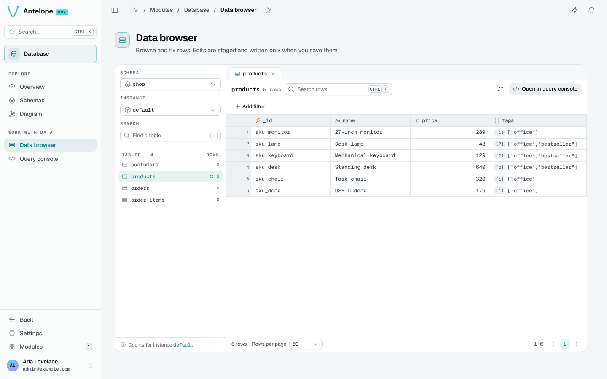
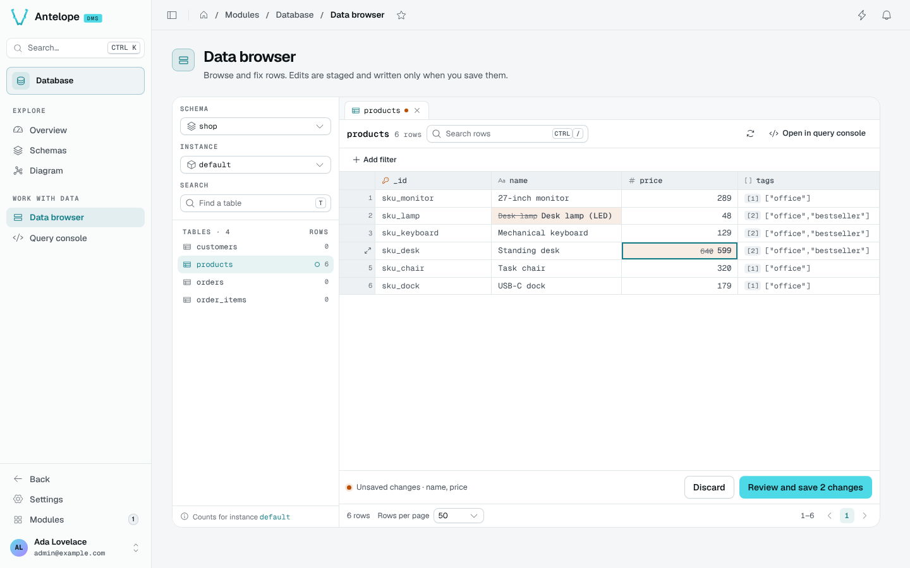

# Data browser

The Data browser (`/modules/database/data`) shows the rows of any registered table. Pick a schema, an instance and a table on the left; open several tables as tabs.

## Browse rows

- **Search rows** (`Ctrl` `/`) searches the open table; **Add filter** adds a column filter (`contains` or `is exactly`).
- Column headers sort the rows; the footer pages through them (25, 50, 100 or 200 rows per page).
- `Space` opens the current row in a side drawer. Its header names the row and its position on the page ("Row 3 of 50"); the previous and next buttons, or `J` and `K`, move between rows. The **Fields** tab edits each column: a long text or a JSON value takes the drawer's width, and the dashed-circle button sets a value to `null`. The footer, always at the drawer's bottom, counts the row's unsaved changes. A **JSON** tab and a **Referenced by** tab complete it.
- **Open in query console** opens the same table in the [Query console](/docs/modules/database/usage/query-console).

Links into the browser carry the selection in the URL: `?schema=shop&table=products`, plus `instance=<name>` for a non-default instance or `instance=all` for every instance.

## Read across instances

With **All instances** picked, the browser reads the table across every instance at once. That view is read-only: pick one instance to edit.

## Edit, review and save

Edits are staged, never written as you type:

::steps
### Edit cells

Double-click a cell, or press `Enter`, and type. Object and array cells open a JSON editor in a side drawer, as tall as the drawer and as wide as you resize it: **Apply** stages the value (`null` empties the cell), **Cancel** leaves it. Edited cells show the old value struck through.

### Review

The bar at the bottom counts the unsaved changes. **Review and save** (`Ctrl` `S`) lists every change before anything is written; **Discard** drops them.

### Save, or undo

Saving writes the changes. For ten seconds, **Undo** puts the previous values back.
::

::warning
A saved edit writes straight to the database, outside of any module's business logic. Prefer the module's own pages to change data that has rules attached.
::

## Keyboard shortcuts

| Key | Action |
| --- | --- |
| `T` | Find a table |
| `Ctrl` `/` | Search rows |
| `R` | Refresh |
| `Enter` | Edit the cell |
| `Space` | Open the row |
| `J` / `K` | Next / previous row |
| `Ctrl` `S` | Review and save |
