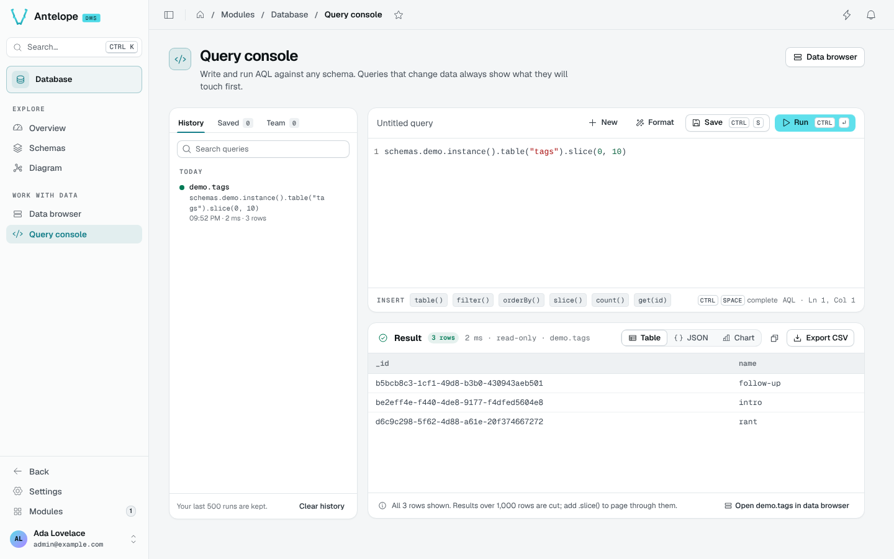
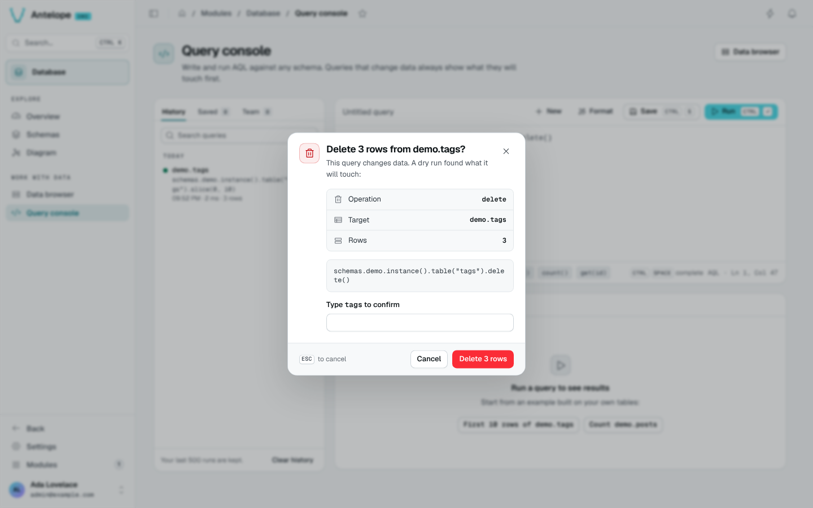

The Query console (`/modules/database/query`) runs AQL, the query language of the AntelopeJS Database interface, against any registered schema.



## Write and run

A query starts from `schemas.<schema>.instance()` and chains the table operations of the Database interface:

```ts fragment
schemas.shop.instance().table("products").orderBy("price").slice(0, 10)
```

`instance()` with no argument reads the default instance. `instance("eu")` reads the named instance `eu`, and `instance(CROSS_INSTANCE)` reads every instance at once. A schema id that is not a valid identifier takes the bracket form, as in `schemas["dms-core"]`.

The editor toolbar and the bar under the editor hold these controls:

- `Ctrl` `Space` completes schemas, instances, tables and columns from your own workspace.
- The **Insert** chips add common operations at the cursor: `table()`, `filter()`, `orderBy()`, `slice()`, `count()`, `get(id)`.
- **Format** strips trailing spaces and the blank lines before and after the query.
- **Run** (`Ctrl` `Enter`) runs the query.
- **New** starts an empty query.

An empty result panel offers two examples built on your own tables. A link from the data browser opens the console on its table, prefilled with `.slice(0, 50)`. The console keeps the query you are writing for the browser tab, so a reload brings it back.

A query that does not parse, or that names an unknown schema, fails before it reaches the server. A syntax error gives its line and column when the parser reports them. A run that fails this way is not kept in the history.

## Read the result

The result header shows the row count, the duration in milliseconds, "read-only" or "changed data", and the target. Choose a view or export:

| View or export | Contents |
| --- | --- |
| **Table** | The first 200 returned rows. |
| **JSON** | Every returned row. |
| **Chart** | Bars of the first 50 returned rows. The X axis and the Y axis are columns you pick. The Y axis starts on the first numeric column. |
| **Copy as JSON** | Every returned row, copied to the clipboard. |
| **Export CSV** | Every returned row, as a CSV file. |

::note
The server returns at most 1,000 rows per run. When it cuts a result, the footer says "Showing 1,000 of n rows" and every view and export holds those 1,000 rows only. Add `.slice()` with a stable ordering to read the rest in pages.
::

Each row that has an `_id` links to that row in the data browser. The footer's **Open `<target>` in data browser** button opens the whole table. A read that finds no row in the default instance lists the named instances that hold rows, and a click reruns the query there.

## Writes are confirmed first

A query that inserts, updates, replaces or deletes never runs straight away:

1. The console sends a dry run first. The dry run measures what the query would change without running it.
2. A dialog shows the operation, the target and the number of rows the write would touch, with the query text. Its title names them, for example "Delete 3 rows from shop.products?".
3. For a delete, a write to more than one row, or a write whose row count the dry run cannot tell, type the table name in the "Type `<table>` to confirm" field.
4. The confirm button, for example **Delete 3 rows**, runs the write. **Cancel** has the focus when the dialog opens.

A single-row update or replace asks without the typed name. Its dialog offers "Don't ask again for single-row updates", which lasts until you close the browser tab. Deletes and writes to more than one row always ask.

::warning
Confirmation executes the write against the database. The dry run is a preview, not a rollback mechanism or a locked snapshot. Data can change before you confirm. Check the target and filter, and back up important data before destructive operations.
::



## History, saved and team queries

The library on the left has three tabs and one search box over all of them:

- **History** lists your last 500 runs, grouped by day. Failed runs are kept too, and a dot marks each run as fast, slow (over 100 ms), failed or changed data. A run can be saved from its row. **Clear history** empties the history and keeps saved queries.
- **Saved** lists the queries you saved, each with a name and a description. **Save** (`Ctrl` `S`) saves the query in the editor. On a saved query of your own, it saves the query in place.
- **Team** lists the queries teammates shared with **Share with team**. Teammates can run a shared query. Only its author can edit or delete it, and the server answers "Saved query not found" to anyone else. Deleting a shared query removes it from the Team tab of every teammate.

## Keyboard shortcuts

On macOS, `⌘` replaces `Ctrl` in **Run** and **Save**. `Ctrl` `Enter` and `Ctrl` `S` act while the editor has the focus.

| Key | Action |
| --- | --- |
| `Ctrl` `Enter` | Run the query |
| `Ctrl` `S` | Save the query |
| `Ctrl` `Space` | Complete the query |
