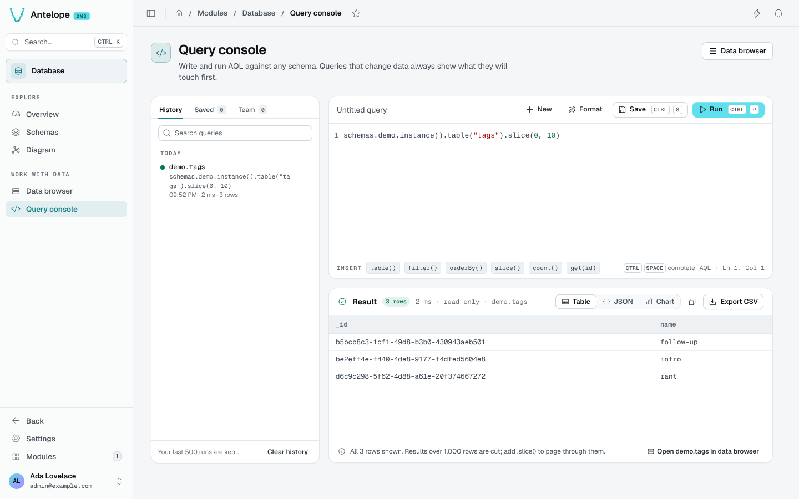
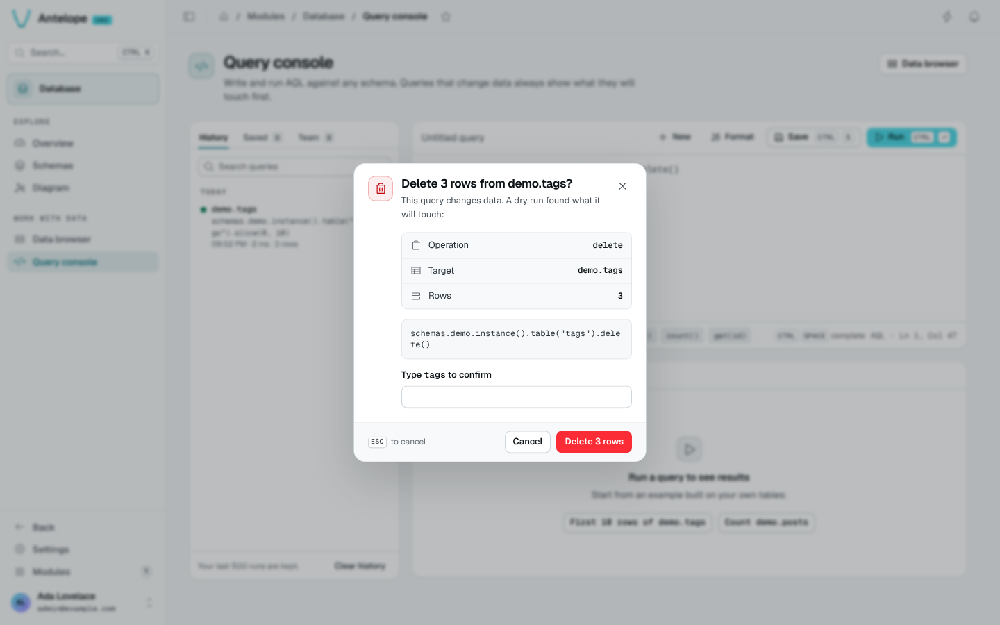

# Query console

The Query console (`/modules/database/query`) runs AQL, the query language of the AntelopeJS Database interface, against any registered schema.



## Write and run

A query starts from `schemas.<schema>.instance(<id>?)` and chains the table operations of the Database interface:

```ts
schemas.shop.instance().table("products").orderBy("price").slice(0, 10)
```

- `Ctrl` `Space` completes schemas, tables and columns from your own workspace.
- The **Insert** chips add common operations: `table()`, `filter()`, `orderBy()`, `slice()`, `count()`, `get(id)`.
- **Format** tidies the query; `Ctrl` `Enter` runs it.
- An empty console offers two examples built on your own tables.

## Read the result

The result shows its row count, duration and target. Switch between **Table**, **JSON** and **Chart** (the first numeric column), copy the rows as JSON, or **Export CSV**. The table shows the first 1,000 rows; JSON and the CSV export hold them all. **Open in data browser** opens the target table.

## Writes are confirmed first

A query that inserts, updates, replaces or deletes never runs straight away. The console runs a **dry run** first and shows the operation, the target and the number of rows it would touch. To confirm, type the table name.



## History, saved and team queries

The library on the left has three tabs:

- **History**: your last 500 runs, grouped by day, searchable. **Clear history** empties it.
- **Saved**: the queries you saved (`Ctrl` `S`), with a name and a description.
- **Team**: the queries teammates shared. Teammates can run a shared query; only its author can edit or delete it.
